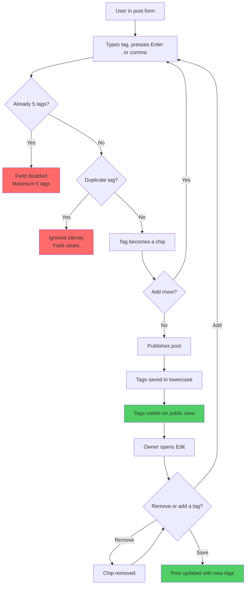

# Flows — Post Tags

---

## Flow 1 — Post with tags, from creation to edit

---

**Legend:**
- 🟥 Red (`fill:#ff6b6b`) — error or blocked state
- 🟩 Green (`fill:#51cf66`) — success or end of flow
- ⬜ No color — normal flow steps
